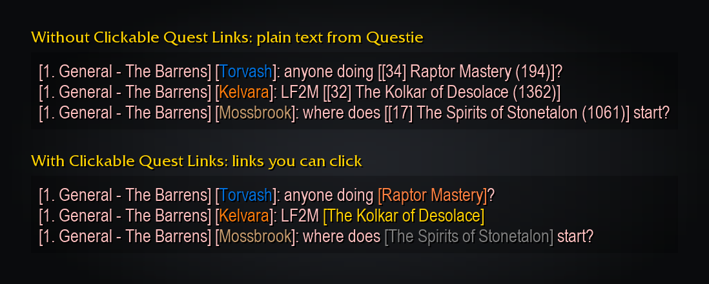

# Clickable Quest Links

A World of Warcraft: Forever addon that makes Questie's quest links clickable for players who don't use Questie.

Questie sends quests in chat as plain text, like `[[34] Raptor Mastery (194)]`, because the chat server strips addon
links. Only another Questie user's game turns that text back into a link; everyone else sees text they can't click.

This addon turns that text into the game's own quest link:



- **Click it** to open Blizzard's quest tooltip. With a [quest database](#quest-databases) installed, the tooltip
  also shows the quest's level, the level it requires, and who starts and ends it, with their zone. That works for
  every quest link you open from chat, including normal ones.
- **Shift-click it** to put it in your chat message. If the quest is in your quest log, it goes in as the game's own
  quest link, which anyone can click. If not, it goes in as Questie's text, which Questie users and players with this
  addon see as a link: a quest link made by an addon arrives as plain text. The same goes for any quest link you
  shift-click from chat.
- **Its colour** shows how hard the quest is for your character, as in the quest log: grey, green, yellow, orange or
  red. To keep links yellow, turn off "Color links by difficulty" in Options, AddOns, Clickable Quest Links (`/cql`
  opens it).

## What gets converted

- `[[34] Raptor Mastery (194)]`, which Questie sends when it shows quest levels. Always converted, even for a quest
  your quest database doesn't have yet.
- `[Raptor Mastery (194)]`, which Questie sends when quest levels are hidden. Only when a quest database or the game
  itself knows that quest by that name, because text like that turns up in normal chat too.
- Item links and other links in the same message are left alone.
- With Questie installed, this addon does nothing: Questie already handles these links.

Messages the game hides from addons, as it can in instances, stay as they are.

## Quest databases

The extra tooltip lines come from whichever of these you already run. When you have more than one, the first in this
list that knows the quest is used:

| Addon | Gives |
| --- | --- |
| [QuestieDB](https://www.curseforge.com/wow/addons/questiedb) | level, required level, who starts and ends the quest, with their zone |
| [Ding!](https://www.curseforge.com/wow/addons/ding-xp-and-leveling-guide) (its DingDB) | the same, and English quest names, so `[Name (id)]` from an English client converts on any client |
| [Polestar Guides](https://www.curseforge.com/wow/addons/polestar) | the same, while one of Polestar's quest features is on (its quest data loads only then) |
| [DonData](https://www.curseforge.com/wow/addons/dondata) (with Questdon or Leveldon) | the required level, and a starter and a finisher once the game or DonData's records know their names; the level comes from the link or the game |

With none of them, links still convert and open Blizzard's own quest tooltip.

RestedXP has no quest data to read: its Forever files map quests to items, and quest and NPC names appear only in
guide text.

## Translations

The tooltip labels are translated for every client language at the top of `ClickableQuestLinks.lua`. Corrections
from native speakers are welcome as an issue or a pull request.

## Development

The tests run the addon on forever_sim, the headless Forever client in
[SkillUp Forever's repository](https://github.com/cjber/skillup-forever), against Blizzard's real chat and tooltip
code. They need LuaJIT, Python 3, curl and a SkillUp Forever clone next to this repository:

```bash
git clone https://github.com/cjber/skillup-forever ../skillup-forever
(cd ../skillup-forever && python3 tools/forever_sim/fetch.py)
tests/run.sh
```

`FOREVER_SIM_REPO` points the tests at a clone somewhere else. CI runs them on every push, pinned to the commit in
`.github/workflows/ci.yml`.

Most scenarios use small stand-ins for the quest databases; the "real" ones read the released QuestieDB, Ding!,
Polestar and DonData. `tests/run.sh` downloads the pinned releases into the sim's cache on the first run and checks
them against their SHA-256; `REAL_QUESTIEDB`, `REAL_DING`, `REAL_DONDATA` and `REAL_POLESTAR` point those scenarios
at other copies. QuestieDB keeps its data base64, zlib and CBOR encoded in TOC metadata and decodes it with
`C_EncodingUtil`, which forever_sim generates from Blizzard's documentation without implementing, so
`tests/encodingutil.lua` implements it for the sim (`tests/encodingutil_test.lua` checks it).

Every Monday, `.github/workflows/drift.yml` runs the "real" scenarios against the newest release of each database
instead of the pinned one, so a change in one of them fails there first; the run's summary lists the releases it
tested. Locally, with gh: `QUESTLINKS_DATABASES=latest tests/run.sh "the real "`.

`tests/ingame/ClickableQuestLinks_SelfTest` is a development-only addon (packages leave `tests/` out). Installed next
to the addon, `/cqltest` sends the same quests through the client's own chat filters and quest tooltip, prints a
summary and keeps the run in its saved variables. That covers what only the real client has: its zone names, its
quest data, Blizzard's tooltip as it runs there, and the colour its quest log gives each quest, which only the client
works out (`C_PlayerInfo.GetContentDifficultyQuestForPlayer`). Each link's colour is checked against it, and a probe of
quests the client has never loaded records whether that answer needs the quest's data. Scenarios run it on the
headless client as well, with the real QuestieDB and with each of the other real databases alone, as the in-game
rounds do with one database enabled.

The two chat screenshots in `docs/screenshots` are drawn from the addon's own output: `tools/scene.lua` runs its chat
filter on forever_sim, and `tools/screenshots.py` draws the result with
[forever-core](https://github.com/cjber/forever-core)'s wowmock, in the client's chat font and class colours. They
need Pillow and a forever-core clone next to this repository (`FOREVER_CORE` points elsewhere):

```bash
git clone https://github.com/cjber/forever-core ../forever-core
python3 tools/screenshots.py
```

The tooltip screenshots are in-game captures.

Pushing a `v*` tag runs the tests, then BigWigsMods/packager builds the zip and publishes it to GitHub Releases,
CurseForge and, when configured, Wago.

## License

MIT
